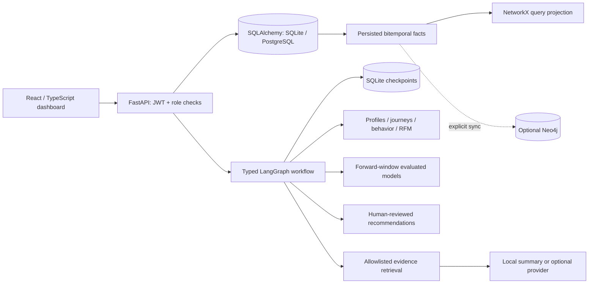

# Architecture and semantics

## Code map

- backend/app/database.py: database connection, foreign keys and SQLite WAL.
- models.py / schemas.py: relational persistence and validated request contracts.
- security.py: scrypt, JWT verification, DB role lookup, audit, process-local limits.
- data.py: atomic event ingestion, derived order/support rows, synthetic generator.
- analytics.py: shared event filters, ordered journeys, profiles, funnels, cohorts.
- temporal_graph.py: idempotent persisted entity/edge construction, snapshots,
  comparisons and patterns; NetworkX and optional parameterized Neo4j adapter.
- ml.py: historical feature extraction and time-separated evaluation.
- intelligence.py: typed LangGraph orchestration, grounded retrieval, proposals.
- main.py: authenticated HTTP boundary, imports, configuration and exports.
- frontend/src/pages: functional modules for navigation groups.
- frontend/src/components/shared.tsx: reusable data tables, charts and feedback.

## Temporal model

Events are immutable facts identified by unique source event IDs. Each stores
event_time (valid-from), optional valid_to, recorded_at (server-controlled
transaction time), source, channel and arbitrary bounded properties. All times
are canonical UTC ISO strings with microsecond precision, so indexed string
comparison works consistently in both supported SQL databases.

Graph entities use namespace-qualified IDs; relationships reference originating
events and persist both clocks and provenance. Ingestion creates an entity edge
and a channel edge in the same transaction. Rebuilding is idempotent.

The snapshot is a cumulative fact graph: valid_from ≤ at, with valid_to excluded
at the boundary, and recorded_at ≤ known_at. An open-ended historical event fact
remains in the cumulative graph; it does not mean a customer is continuously
viewing a product. This supports late-arriving events and reproduces what was
known at an earlier time. Corrections/retractions and transaction-time version
intervals are not implemented; use new distinct source IDs for new facts.

SQL remains authoritative. NetworkX is built from filtered stored facts for graph
algorithms. Neo4j is an explicit optional projection, with no success simulation.

## Agent execution

Profiling → tracking → temporal graph → behavior → segmentation → optional
prediction → recommendation → insight → orchestrator. Conditional routing skips
prediction when disabled by the request or administrator configuration. A customer
scope restricts profile, tracking, behavior, graph and recommendation analysis;
segmentation and model fitting use population evidence to contextualize that scope.

Typed state travels through StateGraph nodes. Outputs must be objects and are
persisted per node. LangGraph checkpoints persist to a separate SQLite database;
each execution ID is its thread ID. Retry policy handles transient exceptions.
Execution records finish as completed or failed. Checkpoints are available for
inspection/recovery engineering, but an HTTP resume API is not yet exposed. Runs
execute synchronously; use a durable worker queue before high-volume deployment.

Recommendations are pending_human_review proposals. There is no outbound action
executor, so sensitive customer interventions cannot happen automatically.

## Prediction validity

Features: recency plus 30-day counts for events, purchases, carts, support, channels.
Training features end 60 days before the latest dataset event; labels cover the
next 30 days. Holdout features end 30 days before the latest event; outcomes cover
the final 30 days. No feature includes a future event. StandardScaler is fitted
only on the training matrix. Customers can appear in both temporal windows, so
this assesses later behavior of known customers, not unseen-customer generalization.

Churn target = no tracked events during the next 30 days. Conversion target = a
purchase during that window. These need complete observation, not just labels.
Minimums: 40 customers, 100 days, 20 holdout observations, both outcome classes,
and at least five examples per training class. Insufficient data returns no score.

Reported metrics are ROC AUC, balanced accuracy, Brier score, class balance, naive
majority baseline accuracy, sample sizes, and cutoff times. Coefficient-based
feature contributions explain model log odds, not causation. Scores are
uncalibrated and have no confidence intervals. Synthetic evaluation is not evidence
of real-world accuracy. CLV forecasting and uplift modeling are deliberately not
claimed because there is no defensible long-term/outcome dataset for them.

## LLM safety and privacy

Questions route to allowlisted analytics templates. No model-produced SQL/Cypher
executes. Aggregated evidence excludes customer names and email addresses.
Optional narration has a structured Pydantic schema, must cite known evidence IDs,
and is rejected for unsupported numeric assertions. This guard is conservative,
not a complete semantic entailment checker. Local summaries explicitly state that
no external model was called and do not invent causal explanations.

## Scaling and deployment limits

The local application deliberately favors readable academic code and modest data
volumes. Some analytics compute in Python, customer profiles cause repeated SQL
reads, uploads cap at 10,000 rows, and graph rendering caps the displayed graph.
Use SQL aggregation, background jobs, distributed rate limiting, persistent
production checkpoints and service monitoring for larger installations. SQLite
WAL and the synchronous server are intended for a single local app instance.

API authorization is workspace-wide RBAC, not multi-tenant isolation. New users
are viewers; analysts can ingest/analyze, administrators configure roles/settings.
Secrets come from server environment; production startup rejects weak/missing JWT
configuration. JWT logout is client-side; refresh/revocation and password recovery
are future work. External HTTPS terminates at deployment infrastructure.
